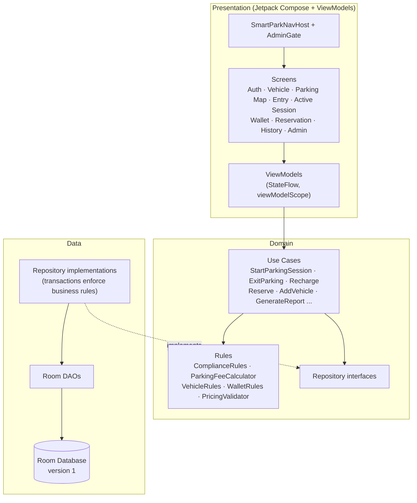
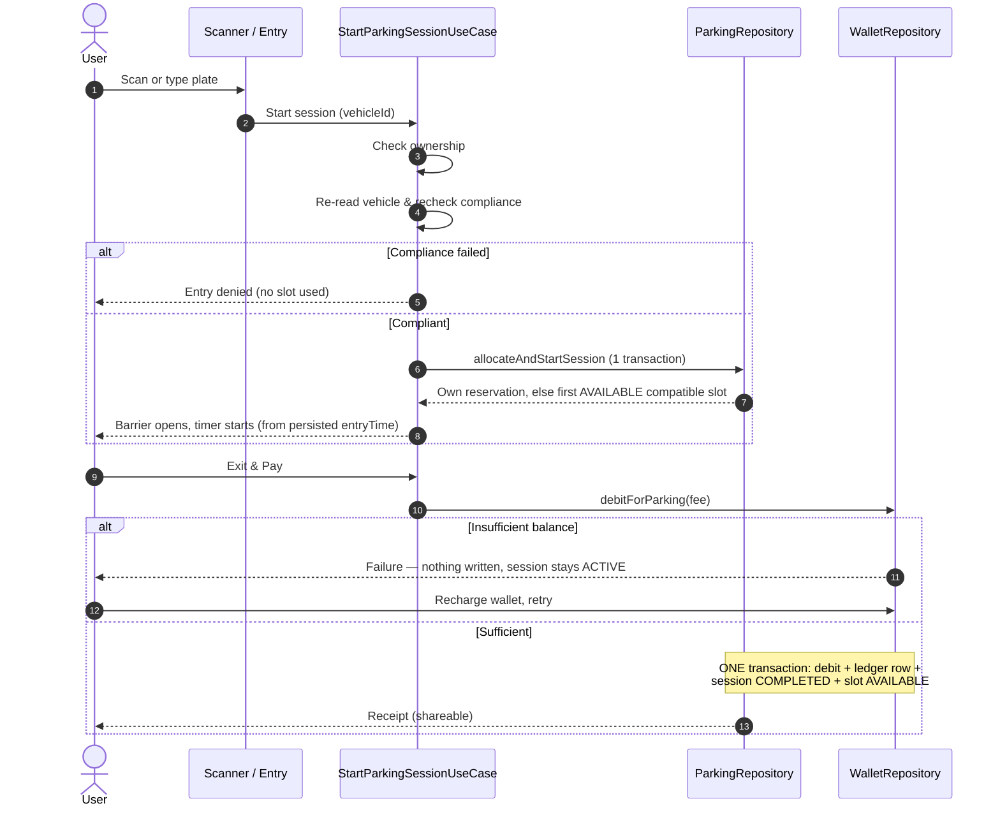
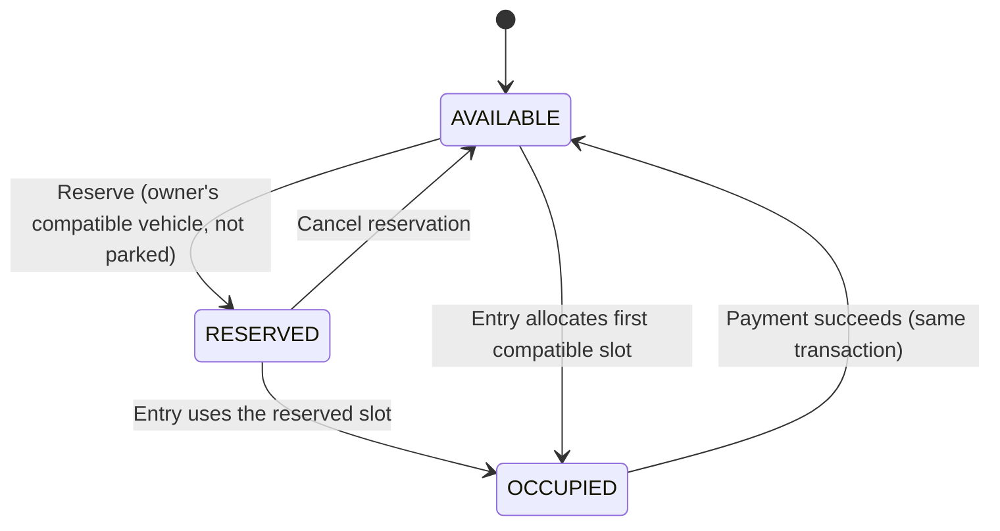
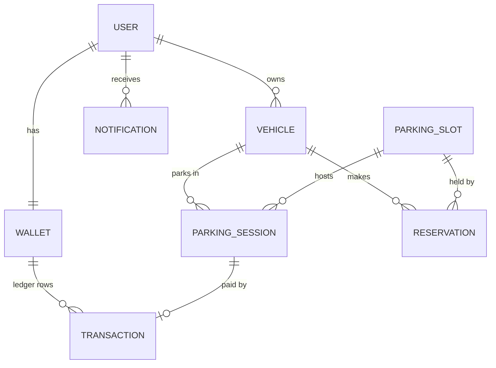
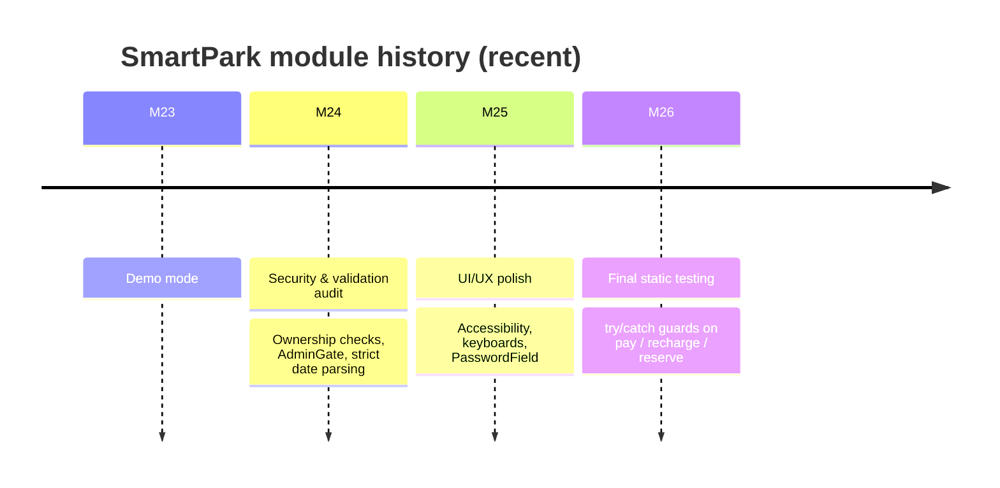

<div align="center">
# 🅿️ SmartPark
 
### Smart parking & vehicle compliance for Android
 


-1A73E8)


 
</div>
---
 
## 📖 Overview
 
**SmartPark** is an Android prototype that manages a parking facility end to end: users register vehicles, the app checks insurance/PUC compliance at the gate, allocates a slot, runs a live parking timer, charges the fee from an in-app wallet, and issues a receipt. Admins manage slots, pricing, analytics and reports.
 
> ⚠️ **Honest status:** all 26 roadmap modules are written, but verification so far is **static only** (code review, import/bracket/schema checks). The project has **not** been built with Gradle or run on an emulator. The first Gradle sync/build is the real test. See [Known Limitations](#-known-limitations).
 
---
 
## ✨ Features
 
| 👤 User | 🛠️ Admin |
|---|---|
| Register / login | Admin dashboard (revenue, session count) |
| Add, edit, delete vehicles | Add / remove / recheck slots |
| Compliance status (insurance, PUC) | Update pricing (validated ≥ ₹1) |
| Scan or manually enter a plate | Analytics screen |
| Entry gate with barrier animation | CSV report export |
| Live parking timer | Role-gated screens (`AdminGate`) |
| Reserve / cancel a slot | |
| Wallet recharge & ledger | |
| Exit & pay, receipt, share | |
| History & notifications | |
| Demo mode (start, walk through, delete data) | |
 
---
 
## 🏗️ Architecture
 
Clean-architecture layering with MVVM in the presentation layer and Hilt for dependency injection.
 

 
### Project layout
 
```
SmartPark/
├── build.gradle.kts          # plugin versions (AGP, Kotlin, Hilt, KSP)
├── settings.gradle.kts       # repositories, :app module
├── gradle.properties
└── app/
    └── src/main/
        ├── AndroidManifest.xml
        ├── res/
        └── java/com/smartpark/
            ├── presentation/   # screens, ViewModels, common components, nav
            ├── domain/         # use cases, rules, repository interfaces
            └── data/           # Room entities/DAOs, repository impls, DI
```
 
---
 
## 🔄 Core Flow: Entry → Park → Exit & Pay
 

 
---
 
## 🅿️ Slot Lifecycle
 

 
---
 
## 🗄️ Data Model
 
Relationships only; see the `data` package for exact columns.
 

 
---
 
## 📏 Business Rules
 
| # | Rule | Where it is enforced |
|---|------|----------------------|
| 1 | Vehicle number is unique (normalized plate) | `VehicleRepositoryImpl` (one transaction) |
| 2 | One ACTIVE session per vehicle | `ParkingRepositoryImpl.allocateAndStartSession` |
| 3 | Reserved/occupied slots are never re-allocated | `allocateAndStartSession`, `ReservationRepositoryImpl` |
| 4 | Wallet balance never goes negative | `WalletRepositoryImpl.debitForParking`, `WalletRules` |
| 5 | Every balance change has a ledger row | Same transaction as the change |
| 6 | A failed payment never completes a session or frees a slot | `completeSessionWithPayment` |
| 7 | No duplicate payment per session | Session status check + payment count guard |
| 8 | Compliance is derived from stored dates (30-day `EXPIRING_SOON` window) | `ComplianceRules` |
| 9 | Timers derive from persisted `entryTime` | `ActiveSessionScreen` |
| 10 | Fee is never zero (rates ≥ ₹1) | `PricingValidator`, `ParkingFeeCalculator` |
 
**Fee example:** 2 h 30 m at the 20 / 20 rate = **₹60**.
 
---
 
## 🧰 Tech Stack
 
| Layer | Technology |
|-------|-----------|
| Language | Kotlin 1.9.24 |
| UI | Jetpack Compose, Material 3 (Compose compiler 1.5.14), `material-icons-extended` |
| DI | Hilt 2.51.1 |
| Persistence | Room (schema version 1), KSP 1.9.24-1.0.20 |
| Build | Android Gradle Plugin 8.5.0 (needs Gradle 8.7+), JDK 17 |
| State | `StateFlow`, `viewModelScope`, coroutines |
 
---
 
## 🚀 Getting Started
 
**Prerequisites:** Android Studio **Koala** or newer, **JDK 17**.
 
1. Open the `SmartPark` folder in Android Studio.
2. Let it sync. There is **no Gradle wrapper** in the project; accept the bundled Gradle prompt, or run `gradle wrapper` once from the project root.
3. Build and run the `app` configuration on an emulator or device.
### Default admin (prototype only)
 
| Field | Value |
|-------|-------|
| Email | `admin@smartpark.local` |
| Password | `Admin@123` |
 
The database is seeded with **30 slots** (zones **A, B, C**), all `AVAILABLE`. Do not use these credentials outside a prototype.
 
---
 
## 🧪 Manual Acceptance Script
 
Run after the first successful build.
 
- [ ] **1.** Register a user, log out, log in (wrong password shows an error)
- [ ] **2.** Add vehicle `MH12AB1234` (CAR) with valid dates; add a second with expired insurance; duplicate plate is rejected
- [ ] **3.** Scanner: manual-enter plate; expired vehicle → "Entry denied", no slot used
- [ ] **4.** Valid vehicle → Entry → Approve: barrier opens, slot shows OCCUPIED, timer runs
- [ ] **5.** Same vehicle Entry again is blocked; reserving a slot for a parked vehicle is rejected
- [ ] **6.** Exit & Pay with ₹0 wallet: "Insufficient balance", session still ACTIVE
- [ ] **7.** Recharge 100 (0, `abc`, 20000 rejected); retry Exit & Pay succeeds; double-tap pays once
- [ ] **8.** Receipt opens and shares; slot AVAILABLE; History lists the session
- [ ] **9.** Admin: dashboard, Analytics, CSV report reflect the session; pricing change (0 and 20000 rejected) affects next fee
- [ ] **10.** Reserve → cancel; reserve → Entry uses that slot; deleting a parked/reserved vehicle is refused
- [ ] **11.** Demo mode: start, walk the steps, delete demo data
- [ ] **12.** Rotate / background the app mid-session: timer and balances stay correct
---
 
## 🗺️ Roadmap Progress
 

 
| Module | Focus | Status |
|--------|-------|--------|
| 05–22 | Core features (auth, vehicles, parking, wallet, reservations, admin, reports) | ✅ Written |
| 23 | Demo mode | ✅ Written |
| 24 | Security & validation audit | ✅ Written |
| 25 | UI/UX polish | ✅ Written |
| 26 | Final testing (static) | ✅ Written |
| — | **First real Gradle build + emulator run** | ⏳ **Pending** |
 
---
 
## ⚠️ Known Limitations
 
1. **Not built or run.** Likely first-build surprises: Compose/Material3 API usage (M23–M25 files), KSP/Room/Hilt generation, `Result<...>` inference in try/catch.
2. **No Gradle wrapper** included (see [Getting Started](#-getting-started)).
3. About **12 ViewModel coroutines** (login, register, sign-out, notification mark-read, pricing load/save, vehicle recheck/add/edit/delete) have no try/catch; a rare DB failure there would crash instead of showing a message.
4. `DeleteVehicleUseCase` checks for active sessions/reservations and deletes in **separate steps**, not one transaction.
5. **No unique indexes** on `users.email`, `vehicles.vehicleNumber`, `wallets.userId`; uniqueness relies on check+insert transactions (an index would need a migration).
6. Vehicle list and parking map briefly show an empty state before data arrives. Slot chip layout, dark-theme contrast and 200% font scale are **not visually checked**.
7. **Security (prototype-grade):** SHA-256 with a static salt, no login throttling, admin credentials shown on the login screen, user screens take `userId` from navigation arguments, demo data mixes into admin totals until deleted.
---
 
## 📸 Screenshots
 
Add screenshots after the first successful run, e.g. under `docs/screenshots/`:
 
| Login | Parking Map | Active Session | Receipt |
|:--:|:--:|:--:|:--:|
| _add image_ | _add image_ | _add image_ | _add image_ |
 
---
 
## 📂 Handover Documents
 
Per-module notes with audits, changed files and checklists: `SmartPark_Handover_Module_24.md`, `SmartPark_Handover_Module_25.md`, `SmartPark_Handover_Module_26.md`.
 
---
 
<div align="center">
Built as a Software Engineering lab project · Prototype, not production-ready
 
</div>
 
